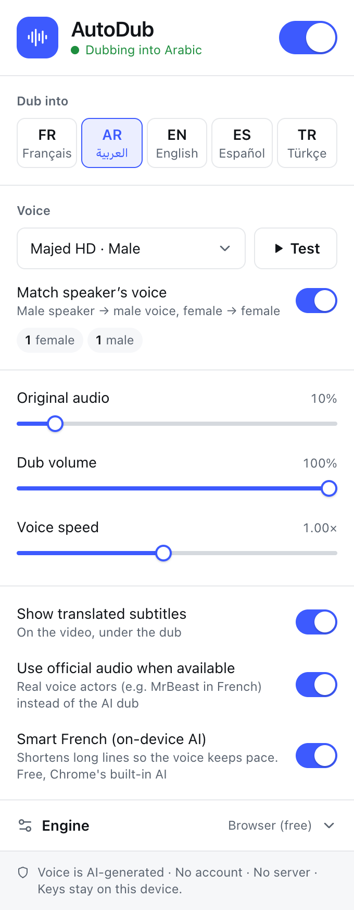
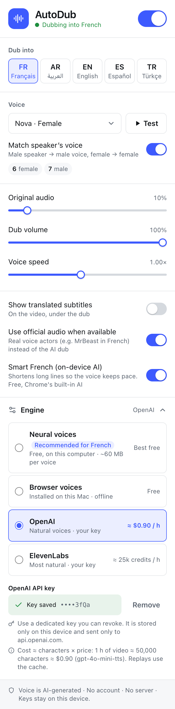
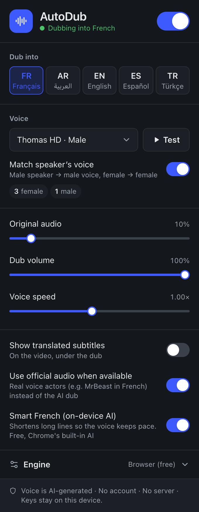

# AutoDub · Doublage YouTube pour Chrome

**Regardez n'importe quelle vidéo YouTube sous-titrée en français, arabe, anglais, espagnol ou turc. AutoDub lit les sous-titres à voix haute dans votre langue pendant la vidéo et baisse le son d'origine. Pensé pour les enfants : un clic, des voix gratuites, et la voix suit la personne qui parle (homme ou femme).**

[](https://github.com/mohoss1985-tech/youtube-auto-dub-chrome/releases/latest/download/autodub-chrome.zip)

🇬🇧 [English version](README.md) · [Journal des versions](CHANGELOG.md)

<p align="center">
  
  
  
</p>

## Nouveautés de la v1.1 · Meilleur français, voix plus fluide

- **Voix neuronales gratuites :** des voix françaises naturelles (une femme et un homme) qui tournent sur votre ordinateur. Choisissez **Neural voices** dans Engine. Téléchargées une fois (~60 Mo chacune), puis hors ligne.
- **Audio français officiel d'abord :** beaucoup de vidéos MrBeast ont de vrais comédiens français sur YouTube. AutoDub bascule dessus automatiquement.
- **Plus fluide :** vitesse régulière, plus de silence suivi d'un débit rapide ; la voix ne passe d'homme à femme que si la personne qui parle change vraiment.
- **Français plus propre :** plus de « euh », de [Musique] ni de paroles de chansons lues ; nombres et mots de la NBA dits à la française. L'option **Smart French** utilise l'IA intégrée gratuite de Chrome pour raccourcir les phrases trop longues.

## Installation en 2 minutes (sans le Chrome Web Store)

1. **[Téléchargez `autodub-chrome.zip`](https://github.com/mohoss1985-tech/youtube-auto-dub-chrome/releases/latest/download/autodub-chrome.zip)** et double-cliquez dessus pour le décompresser. Vous obtenez un dossier `autodub-chrome`.
   Rangez-le à un endroit où il restera (par exemple dans Documents) : Chrome le charge depuis cet endroit à chaque fois.
2. Dans Chrome, ouvrez **`chrome://extensions`** (tapez-le dans la barre d'adresse).
3. Activez le **Mode développeur** (interrupteur en haut à droite).
4. Cliquez sur **Charger l'extension non empaquetée** et choisissez le dossier `autodub-chrome`.
5. Cliquez sur l'icône puzzle 🧩 de la barre d'outils et **épinglez AutoDub**.

Fonctionne avec Chrome 138 ou plus récent sur Mac, Windows et Linux. Brave et Edge devraient aussi marcher (non testés).

## Utilisation

1. Ouvrez une vidéo YouTube qui a des sous-titres (une seule langue suffit, les sous-titres automatiques marchent aussi).
2. Cliquez sur **Dub** dans la barre du lecteur (à côté de CC), ou appuyez sur **Alt+D**, ou utilisez l'interrupteur de la fenêtre AutoDub.
3. Choisissez la langue dans la fenêtre : **FR · AR · EN · ES · TR**.
4. Cliquez de nouveau sur **Dub** pour retrouver le son d'origine.

| Réglage | Ce qu'il fait |
|---|---|
| **Original audio** | Volume du son d'origine sous le doublage (10 % par défaut, 0 % = seulement le doublage) |
| **Voice** + ▶ Test | Choix de la voix ; chaque voix est marquée Male (homme) ou Female (femme) |
| **Match speaker's voice** | Un homme parle → voix d'homme, une femme → voix de femme |
| **Voice speed** | De 0,75× (plus lent, idéal pour les petits) à 1,3× |
| **Show translated subtitles** | Affiche la phrase traduite sur la vidéo |
| **Engine** | Voix gratuites (par défaut), ou OpenAI / ElevenLabs avec votre propre clé |

L'interface de l'extension est en anglais ; le doublage, lui, est dans la langue choisie.

## Comment ça marche

```
Sous-titres YouTube ──► phrases ──► traduction ──► voix ──► jouée en rythme avec la vidéo
                                     (gratuite       (voix gratuites du Mac/PC,
                                      d'abord)        ou votre clé IA)
```

- **Traduction, gratuite d'abord :** sous-titres déjà dans votre langue → sous-titres traduits par YouTube → **traducteur intégré de Chrome** (tourne sur votre ordinateur, télécharge un pack de langue la première fois) → OpenAI, seulement si vous ajoutez une clé.
- **Synchronisé :** la voix suit l'horloge de la vidéo. Pause, avance, changement de vitesse : le doublage suit. Pendant les pubs, le doublage s'arrête et la pub passe normalement.
- **Voix continue :** une phrase n'est jamais coupée au milieu. Si elle déborde, la suivante attend puis parle un peu plus vite pour rattraper.
- **Homme ou femme :** AutoDub écoute la hauteur de la voix d'origine et choisit une voix d'homme ou de femme. Les indications des sous-titres comme `[Homme]` passent avant cette estimation.

## De meilleures voix (gratuites)

Les voix gratuites sont celles installées sur votre ordinateur.
- **Mac :** Réglages Système → Accessibilité → Contenu énoncé → Voix du système → **Gérer les voix**. Téléchargez les voix « Améliorée » ou « Premium » en français, arabe, espagnol et turc (un homme et une femme pour chaque langue, pour que la voix suive la personne qui parle).
- **Windows :** Paramètres → Heure et langue → Voix → **Ajouter des voix**.

La fenêtre AutoDub indique combien de voix d'homme et de femme chaque langue possède.

## Voix payantes (facultatif)

Pour des voix plus naturelles, ouvrez **Engine** dans la fenêtre et choisissez OpenAI ou ElevenLabs avec votre propre clé API (environ 1 $ par heure de vidéo). Utilisez une clé dédiée que vous pouvez révoquer et fixez une limite de dépense chez le fournisseur. AutoDub ne fait jamais d'appel payant sans votre clé.

## Confidentialité

Pas de compte, pas de serveur, pas de statistiques. Les réglages, les avis 👍 / 👎 et les clés restent dans Chrome sur votre ordinateur. Les clés ne sont envoyées qu'au fournisseur choisi. La voix est générée par IA, et un badge « AI dub » sur le lecteur l'indique.

## Limites

- **Usage personnel uniquement.** AutoDub ne télécharge ni ne republie jamais de vidéo ou de son. Ne publiez pas d'enregistrements doublés : c'est contraire aux conditions de YouTube et aux droits des créateurs.
- Les vidéos **sans aucun sous-titre** ne peuvent pas encore être doublées.
- Pas encore pour les Shorts, le site YouTube Kids, les téléphones ni les applis TV.
- **Homme ou femme reste une estimation.** Dessins animés, chansons et voix d'enfants (aiguës → voix de femme) peuvent la tromper.
- Au démarrage, Chrome peut afficher « Désactiver les extensions en mode développeur ». Cliquez sur **Conserver** (ou ×) : c'est normal pour une extension installée de cette façon.
- **Licences des voix neuronales :** les modèles de voix sont téléchargés depuis le projet Piper (rhasspy/piper-voices) par votre navigateur, ils ne sont pas inclus ici. Certains sont réservés à un usage non commercial (la voix masculine française Tom est sous AGPL-3.0 ; les voix anglaises et turques sous CC BY-NC-SA). Aucun souci pour un usage personnel.
- Sans lien avec YouTube ni Google. « AutoDub » est le nom de travail du projet ; une autre extension Chrome, sans rapport, porte aussi ce nom.

## Mise à jour

Téléchargez le nouveau zip, remplacez l'ancien dossier `autodub-chrome`, puis cliquez sur **↻** sur AutoDub dans `chrome://extensions`.

## Pour les développeurs

TypeScript, Manifest V3, esbuild, Vitest, Playwright. Aucune dépendance à l'exécution, aucun code distant.

| Commande | Rôle |
|---|---|
| `npm install && npm run build` | construit l'extension dans `dist/` |
| `npm test` | 289 tests unitaires |
| `npm run typecheck` | TypeScript |
| `npx playwright test` | captures de la fenêtre + test de fumée |

Comment il a été construit : [`GOAL.md`](GOAL.md) (objectif et « fini veut dire »), [`DESIGN_SPEC.md`](DESIGN_SPEC.md) (architecture, algorithme de synchro, contrat partagé), [`research/`](research/) (fonctionnement de YouTube, voix et synchro, concurrents, Chrome Web Store et juridique). Construit avec Claude Code.

Licence MIT.
