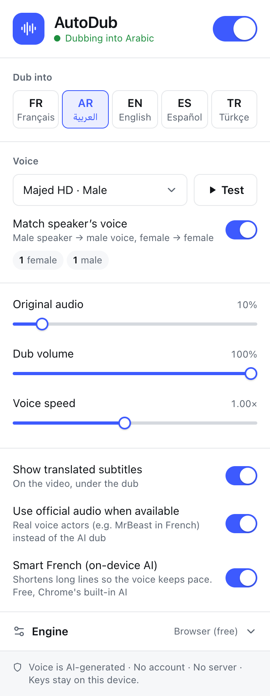
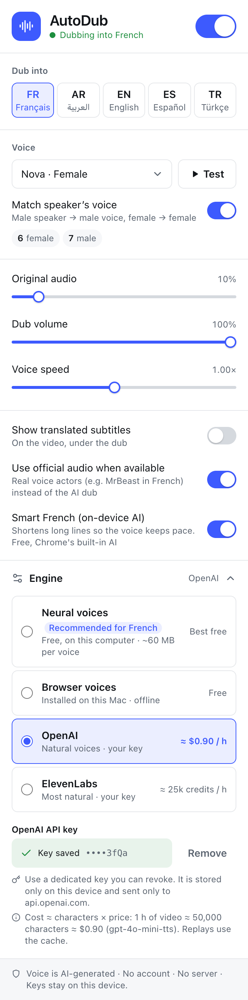
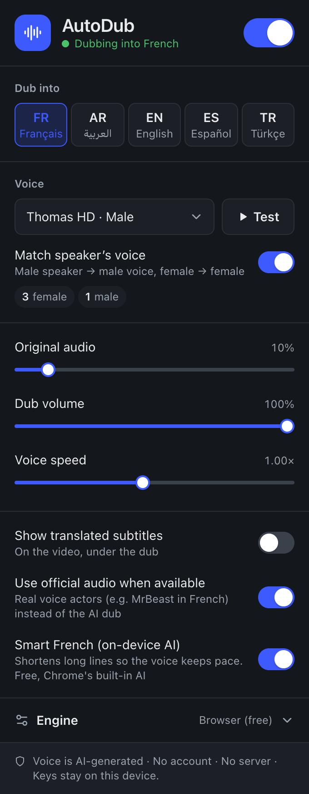

# AutoDub · YouTube dubbing for Chrome

**Watch any YouTube video with subtitles in French, Arabic, English, Spanish or Turkish. AutoDub reads the subtitles out loud in your language while the video plays, and turns the original sound down. Made for kids: one click, free voices, and the voice follows the speaker (man or woman).**

[](https://github.com/mohoss1985-tech/youtube-auto-dub-chrome/releases/latest/download/autodub-chrome.zip)

🇫🇷 [Version française](README.fr.md) · [Changelog](CHANGELOG.md)

<p align="center">
  
  
  
</p>

## New in v1.1 · Better French, smoother voice

- **Neural voices, free:** natural French voices (a woman and a man) that run on your computer. Pick **Neural voices** in Engine. They download once (~60 MB each), then work offline.
- **Official French audio first:** many MrBeast videos have real French voice actors on YouTube. AutoDub switches to them automatically.
- **Smoother:** steady speed, no more silence then fast talking; the voice changes between a man and a woman only when the speaker really changes.
- **Cleaner French:** no more "um", [Music] or song lyrics read out; numbers and NBA words said the French way. Optional **Smart French** uses Chrome's free built-in AI to shorten lines that are too long.

## Install in 2 minutes (no Chrome Web Store needed)

1. **[Download `autodub-chrome.zip`](https://github.com/mohoss1985-tech/youtube-auto-dub-chrome/releases/latest/download/autodub-chrome.zip)** and double-click it to unzip. You get a folder called `autodub-chrome`.
   Put it somewhere it will stay (for example in Documents): Chrome loads it from there every time.
2. In Chrome, open **`chrome://extensions`** (type it in the address bar).
3. Turn on **Developer mode** (switch at the top right).
4. Click **Load unpacked** and pick the `autodub-chrome` folder.
5. Click the puzzle icon 🧩 in the toolbar and **pin AutoDub**.

Works in Chrome 138 or newer on Mac, Windows and Linux. Brave and Edge should work too (not tested).

## Use it

1. Open a YouTube video that has subtitles (one language is enough, auto-generated ones work too).
2. Click **Dub** in the player bar (next to CC), or press **Alt+D**, or use the switch in the AutoDub popup.
3. Pick the language in the popup: **FR · AR · EN · ES · TR**.
4. Click **Dub** again to get the original sound back.

| Setting | What it does |
|---|---|
| **Original audio** | How loud the original stays under the dub (10 % by default, 0 % = only the dub) |
| **Voice** + ▶ Test | Choose the voice; each one is labelled Male or Female |
| **Match speaker's voice** | A man speaking → male voice, a woman → female voice |
| **Voice speed** | 0.75× (slower, good for small kids) to 1.3× |
| **Show translated subtitles** | Shows the translated sentence on the video |
| **Engine** | Free voices (default), or OpenAI / ElevenLabs with your own key |

## How it works

```
YouTube subtitles ──► sentences ──► translation ──► voice ──► played in time with the video
                                     (free first)    (free Mac/PC voices,
                                                      or your own AI key)
```

- **Translation, free first:** subtitles already in your language → YouTube's own translated subtitles → **Chrome's built-in translator** (runs on your computer, downloads a language pack the first time) → OpenAI, only if you add a key.
- **In sync:** the voice follows the video's clock. Pause, seek or change speed and the dub follows. During ads the dub pauses and the ad plays normally.
- **Continuous voice:** a sentence is never cut in the middle. If one runs long, the next waits and speaks a little faster to catch up.
- **Man or woman:** AutoDub listens to the pitch of the original voice and picks a male or female voice. Subtitle labels like `[Man]` win over the guess.

## Better voices (free)

The free voices are the ones installed on your computer.
- **Mac:** System Settings → Accessibility → Spoken Content → System voice → **Manage voices**. Download the "Enhanced" or "Premium" voices for French, Arabic, Spanish and Turkish (a man and a woman for each, so speaker matching works).
- **Windows:** Settings → Time & language → Speech → **Add voices**.

The popup shows how many male and female voices each language has.

## Paid voices (optional)

For more natural voices, open **Engine** in the popup and choose OpenAI or ElevenLabs with your own API key (about $1 per hour of video). Use a dedicated key you can revoke and set a spending limit in the provider's dashboard. AutoDub never makes a paid call without your key.

## Privacy

No account, no server, no analytics. Settings, 👍 / 👎 feedback and keys stay in Chrome on your computer. Keys are only sent to the provider you picked. The voice is AI-generated, and an "AI dub" badge on the player says so.

## Limits

- **Personal viewing only.** AutoDub never downloads or re-uploads video or audio. Don't publish dubbed recordings: it breaks YouTube's terms and the creators' copyright.
- Videos **without any subtitles** can't be dubbed yet.
- Not for Shorts, the YouTube Kids site, phones or TV apps (yet).
- **Man or woman is a best guess.** Cartoons, songs and children's voices (high-pitched → female voice) can fool it.
- On startup Chrome may show "Disable developer mode extensions". Click **Keep** (or ×): that's normal for extensions installed this way.
- **Neural voice licences:** the voice models are downloaded from the Piper project (rhasspy/piper-voices) by your browser, not shipped here. Some are for non-commercial use only (the French male voice Tom is AGPL-3.0; the English and Turkish voices are CC BY-NC-SA). Fine for personal use.
- Not affiliated with YouTube or Google. "AutoDub" is the project's working name. Another, unrelated Chrome extension also uses this name.

## Update

Download the new zip, replace the old `autodub-chrome` folder with it, then click **↻** on AutoDub in `chrome://extensions`.

## For developers

TypeScript, Manifest V3, esbuild, Vitest, Playwright. No runtime dependencies, no remote code.

| Command | What |
|---|---|
| `npm install && npm run build` | build the extension to `dist/` |
| `npm test` | 289 unit tests |
| `npm run typecheck` | TypeScript |
| `npx playwright test` | popup screenshots + smoke test |

How it was built: [`GOAL.md`](GOAL.md) (outcome and "done means"), [`DESIGN_SPEC.md`](DESIGN_SPEC.md) (architecture, sync algorithm, shared contract), [`research/`](research/) (YouTube internals, voices and sync, competitors, Chrome Web Store and legal). Built with Claude Code.

MIT licence.
